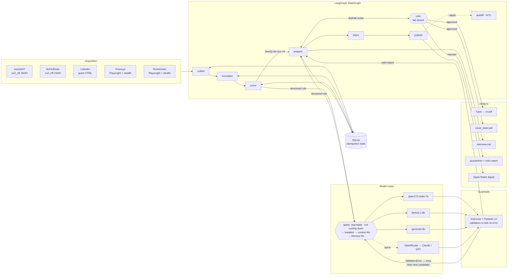
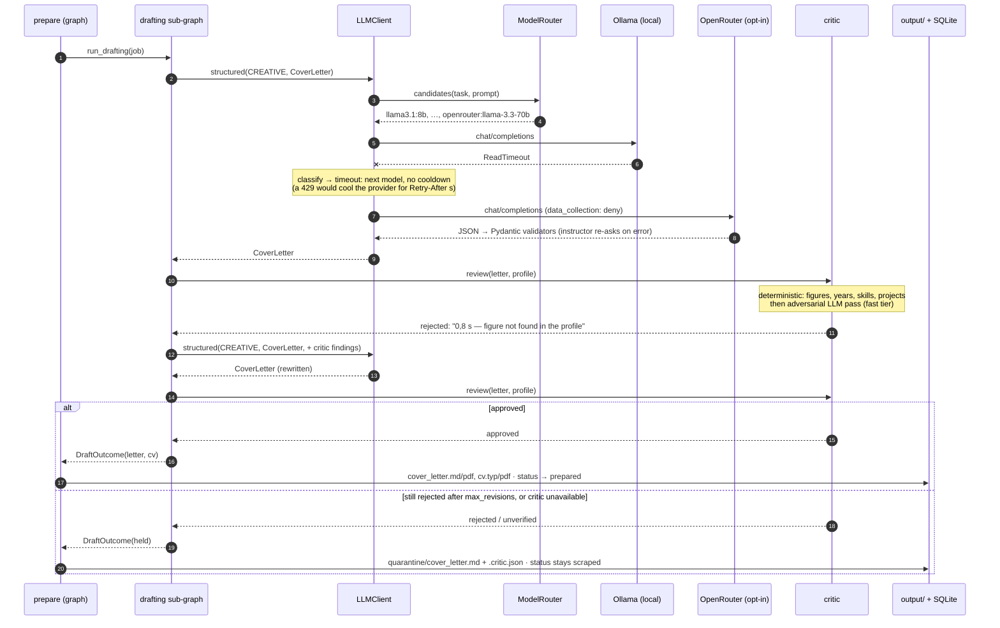
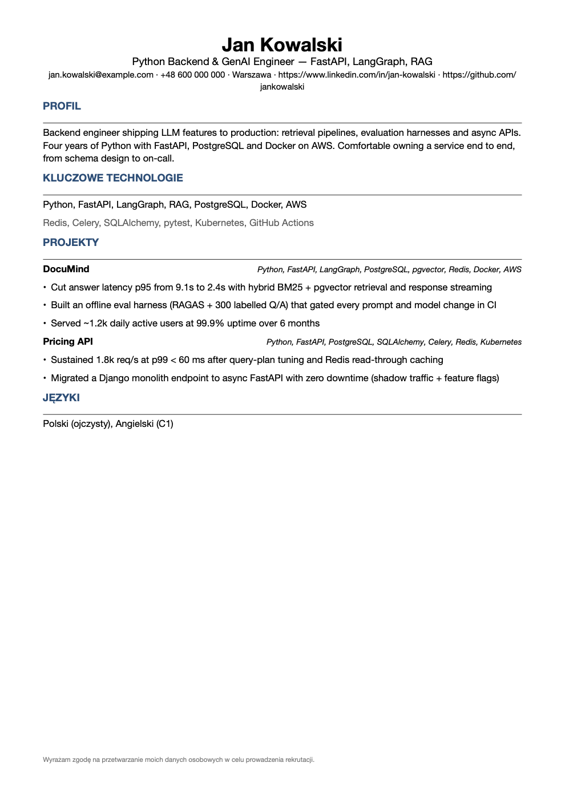
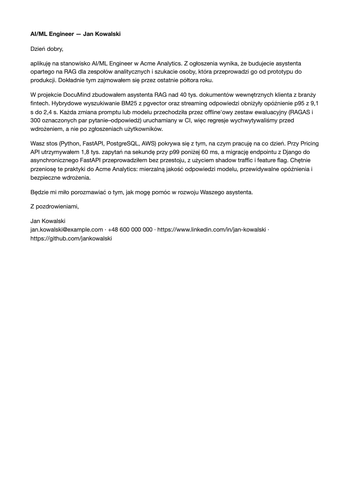

<div align="center">

# JobHunter-Agent

**A local-first agentic pipeline that scrapes job boards, ranks offers against your profile, and writes a tailored CV and cover letter for each match, using open-weight LLMs on your own machine.**

[](https://www.python.org/)
[](https://github.com/langchain-ai/langgraph)
[-000000)](https://ollama.com/)
[](https://docs.pydantic.dev/)
[](https://typst.app/)
[](https://github.com/mikeZ98/jobhunter-agent/actions/workflows/ci.yml)
[](#testing)
[](https://docs.astral.sh/ruff/)
[](LICENSE)

</div>

---

## Overview

JobHunter-Agent is a **human-in-the-loop, multi-agent system** for tech job search. Each morning it:

1. **Collects** fresh offers from five Polish job boards (JustJoinIT, NoFluffJobs, Pracuj.pl, RocketJobs, LinkedIn).
2. **Normalizes** them: dedup, salary converted to a monthly B2B-equivalent in PLN, seniority and remote mode inferred.
3. **Scores** each offer against your profile with a hybrid of skill overlap, embedding similarity, and an LLM rubric judge.
4. **Writes** a tailored CV (Typst → PDF), a Polish cover letter, and an interview cheat sheet for the top 10–15 offers, then has an **adversarial critic** fact-check every CV and letter against your profile. Drafts that fail are rewritten once with the critic's findings and are otherwise **quarantined**, never delivered.
5. **Publishes** a digest to Apple Notes and, when you ask, **pre-fills the application forms in your browser and stops** so you can review and click Submit yourself.

Everything runs on **local open-weight models via Ollama**. Your CV, profile and the job data stay on your machine. Cloud models (OpenRouter, then Anthropic / OpenAI) are strictly opt-in: a provider is used only once you put its API key in `.env`, and `local_only = true` forbids them entirely. OpenRouter requests ask for hosts that don't store prompts (`data_collection: deny`).

> **It never submits anything.** The autofill module contains no click, press or submit calls (a test parses the module's AST to enforce that). It never ticks consent boxes, never overwrites fields the site pre-filled, and waits for you at a CLI prompt for every application.

---

## Architecture

### Pipeline at a glance



### Graph topology (`src/jobhunter/graph.py`, `src/jobhunter/workflow/`)

```
START → collect → normalize → score ─┬─► prepare ×N (Send fan-out) ─┐
                                      └──────────────────────────────┴─► inbox → publish ─┬─► autofill (HITL, --apply) → END
                                                                                          └─────────────────────────────► END

prepare, per job:   drafting sub-graph  ‖  interview intel
                    draft ──► critique ──┬──► END    approved · critic unavailable · out of revisions
                      ▲                  │
                      └──── revise ◄─────┘           rejected with findings → rewrite with them
```

Every node is **idempotent against SQLite**. A crashed or interrupted run resumes without downloading listings again. A job without an approved cover letter stays in `scraped` state. If generation failed or the critic couldn't run, the next run retries it, for up to 7 days. If the critic **quarantined** the letter, it waits for you instead of being regenerated every morning.

Every transition is a **strict Pydantic v2 contract** (`workflow/schemas.py`). Each node builds its state update through a frozen `extra="forbid"`, `strict=True` model, and domain objects must arrive as instances, so a misspelled channel or a raw dict fails at the node that produced it. `RunRequest` validates the graph input, so `--board typo` fails before a browser starts.

### One job through `prepare`

How a single shortlisted job becomes assets. Here the local model times out, OpenRouter (opted in) writes the letter, and the critic catches a figure the profile never states:



### Agents

| # | Agent | Module | Responsibility |
|---|-------|--------|----------------|
| 1 | Collector & Normalizer | `agents/collector.py` | All boards run concurrently; each board runs sequentially behind a rate limiter. Dedups against SQLite *before* fetching details. Converts salaries to monthly PLN B2B-equivalent (UoP gross × factor, hourly × 168, NBP FX). LLM extraction runs only for listings that pass the prefilter but are missing facts. |
| 2 | Matching & Scoring | `agents/scorer.py` | Hard prefilter → alias-aware skill overlap → embedding similarity vs. `base_cv.md` → LLM rubric judge on the top 40 → weighted final score → top 10–15. |
| 3 | Application Assets | `agents/assets.py` | Polish cover letter plus tailored CV. Validators **reject invented skills and projects**, and instructor re-asks the model with the error. |
| 3b | Adversarial Critic | `agents/critic.py` | Fact-checks every draft against the canonical profile: figures, experience years, project attribution, job-ad technologies claimed as experience. **Fails closed.** Runs inside the drafting sub-graph (`workflow/drafting.py`). |
| 4 | Interview Intel | `agents/interview.py` | Likely stack-specific questions with answer outlines tied to your projects, and exactly 3 non-generic reverse-interview questions. |
| 5 | Form Autofill | `agents/autofill.py` | Selector-agnostic field scan (label / aria / placeholder / autocomplete, iframes included) → PL/EN regex rules → batched LLM for unknown questions → fill + CV upload → `[ACTION REQUIRED]` prompt. |
| 6 | LinkedIn Messaging | `agents/linkedin_messaging.py` | Triages recruiter messages and drafts replies. **Never sends.** |

---

## Engineering highlights

### 1. Graph orchestration with fallbacks at every layer

- **LangGraph `StateGraph`** with `Send` fan-out for per-job preparation and an `operator.add` reducer that merges results.
- **Per-board failure isolation.** A Cloudflare challenge on one board never blocks the digest. After N challenges a per-board circuit breaker opens, a macOS notification fires, and the event is logged to `antibot_events`.
- **Model failover** (`llm/router.py`). Each task walks an ordered candidate list through four gates: *provider reachable, not cooling down and not disabled → model installed (`/api/tags`) → prompt fits the context window → model fits in free memory (or is already resident per `/api/ps`)*. If nothing is eligible, `NoModelAvailable` lists the reason for each skipped model and the classified failure of each one tried.

| Task | Local chain (default) | Cloud fallback, in order (opt-in) |
|------|-----------------------|-----------------------------------|
| extract / score / validate | `qwen2.5-coder:7b` → `llama3.1:8b` | OpenRouter `llama-3.1-8b-instruct`, `claude-haiku-5-5`, `gpt-4o-mini` |
| form answers / messaging | `llama3.1:8b` → `qwen2.5-coder:7b` | OpenRouter `llama-3.1-8b-instruct`, `claude-haiku-5-5`, `gpt-4o-mini` |
| CV + cover letter | `llama3.1:8b` → `qwen2.5-coder:7b` | OpenRouter `llama-3.3-70b-instruct`, `claude-sonnet-5-5`, `gpt-4o` |
| interview intel | `llama3.1:8b` → `qwen2.5-coder:7b` | OpenRouter `llama-3.3-70b-instruct`, `claude-sonnet-5-5`, `gpt-4o` |

The chains are plain lists in `jobhunter.toml`. On 16 GB, appending `gemma3:4b` gives the router a small model to fall back to when memory is tight. With `prefer_local = false` the cloud goes first and local Ollama becomes the fallback.

- **Failures are classified, not just caught** (`llm/errors.py`). instructor wraps every provider error in `InstructorRetryException`, so the client walks the cause chain before reacting:

| Kind | Example | Reaction |
|------|---------|----------|
| `timeout` | model load + generation > `request_timeout_s` | next candidate; the provider stays usable |
| `rate_limit` | HTTP 429 | provider **cools down** for `Retry-After` s, so the rest of the batch skips it; if only rate-limited models are left, wait once (≤ `rate_limit_max_wait_s`) |
| `auth` | HTTP 401 / 402 / 403 | provider disabled for the run |
| `connection` | refused, DNS | Ollama re-probed; a cloud provider cools down briefly |
| `empty_reply` | Ollama HTTP 200 with no body (Metal OOM) | unload models, retry once, then next |
| `validation` / `server` / `bad_request` | re-asks exhausted, 5xx, 4xx | next candidate |

  The kind is stored in `llm_calls.error` and counted in `llm.failures`. Local SDK clients don't retry internally (`max_retries=0`): re-sending a request that already ran for `request_timeout_s` only tripled the wait.

### 2. Pydantic v2 as an anti-hallucination layer

Anti-hallucination rules live in the **schema**, not in the prompt. Validators receive the candidate profile through instructor's validation `context`, so every rule is enforced in code:

```python
class TailoredCV(BaseModel):
    headline: str = Field(max_length=90)
    summary: str = Field(max_length=600)
    skills_primary: list[str] = Field(min_length=4, max_length=10)
    projects: list[TailoredProject] = Field(min_length=2, max_length=4)

    @field_validator("headline", "summary", mode="before")
    @classmethod
    def _clip_text(cls, v, info):
        # Small models overshoot length limits by a few characters; trimming beats burning retries.
        ...

    @field_validator("skills_primary", "skills_secondary", mode="before")
    @classmethod
    def skills_must_exist(cls, v, info):
        """Drop skills absent from the profile (never invent), then clip to the field's limit."""
        ...
```

- **Grounding:** a CV may only list skills and projects that exist in `profile.json`. Anything else fails validation, and the error is sent back to the model.
- **Quality bounds:** a cover letter must be 150–360 words, name a real project and the target company, and avoid a banned list of Polish and English boilerplate (`"z dużym zainteresowaniem"`, `"team player"`, …).
- **Deterministic scoring:** the LLM judge scores four rubric parts (stack, role, seniority, logistics) separately and **the code sums them**, so a 7B model can't give every offer 85.
- **Trim, don't retry:** near-miss length overruns are clipped in `mode="before"` validators instead of costing another 3–5 minute local generation.

Real validation failures from a run, each caught and fed back to the model:

```
creative ollama:llama3.1:8b ok=False
  List should have at most 10 items after validation, not 12 [type=too_long]
creative ollama:qwen2.5-coder:7b ok=False
  Value error, Skills not in candidate profile (do not invent): ['Machine Learning', 'Deep Learning', 'Industrial Automation']
creative ollama:gemma3:4b ok=False
  Value error, Remove corporate boilerplate phrases: ['z dużym zainteresowaniem']. Replace with concrete facts.
```

### 3. Adversarial critic: fail closed

The validators above keep a draft *well-formed*. They can't see an invented latency, Kafka copied from the job ad into "my experience", or one project's metric moved onto another. `agents/critic.py` assumes the writer oversold:

1. **Deterministic pass**, which can't be argued with. Every figure must occur in `profile.json` or `base_cv.md` (a letter may also quote the job ad). CV bullets may only use figures from *that* project's own highlights. "N lat / years" claims must match the profile. CV skills and projects must exist. Job-ad technologies the profile lacks become *suspects* (Polish inflection included: *Kafką*, *Dockerze*).
2. **Adversarial LLM pass** (fast tier, temperature 0). It lists unsupported or contradicted statements and must answer, for **every** suspect, whether the draft claims experience with it. A verdict that skips one is re-asked.

**Approval is computed in code from the findings, never taken from the model.** A critic that can't run rejects the draft. A rejected draft is rewritten with the findings (`[critic] max_revisions`, default 1) and is then quarantined. Only approved drafts become `cover_letter.*` / `cv.*`, so autofill can never upload an unverified document.

### 4. Resource-aware inference on a 16 GB Apple Silicon Mac

On unified memory, two or three 4–8B models at 12k context don't fit together. When Metal runs out of memory, Ollama replies **HTTP 200 with an empty body**. The client handles this explicitly:

- **One model resident at a time** (`ollama_single_model = true`). The client unloads the previous model before switching, and the router counts that memory as free.
- **Serialized local calls** (`ollama_parallel = 1`).
- **Empty reply = backend failure**, not a validation failure: unload, retry once, then fall through.
- **Context-window correctness.** Ollama's default context (4096) silently truncates prompts, and its OpenAI-compatible endpoint ignores `num_ctx`. The client therefore creates a `<tag>-jh12k` alias per model (a manifest only: same weights, no extra disk), and the router refuses prompts that wouldn't fit.
- Models are unloaded before the Apple Notes step, and Ollama.app is started automatically if it isn't running.

### 5. Typst document compilation

CVs are rendered to **Typst** source (`cv.typ`), with user text escaped against Typst markup, and compiled to PDF with the `typst` Python package or CLI. If neither is available, they fall back to headless Chromium. Cover letters go Markdown → PDF via Chromium. Example output is in [`docs/assets/sample/`](docs/assets/sample/) (fictional profile).

| Tailored CV (Typst) | Cover letter |
|:---:|:---:|
| [](docs/assets/sample/cv.pdf) | [](docs/assets/sample/cover_letter.pdf) |

### 6. Anti-ban and acquisition

| Board | Strategy |
|-------|----------|
| JustJoinIT | `curl_cffi` JSON: candidate-api offers + detail endpoint |
| NoFluffJobs | `curl_cffi` JSON: `POST /api/search/posting` + `/api/posting/{id}` |
| LinkedIn | `curl_cffi` HTML: logged-out `jobs-guest` fragments |
| Pracuj.pl | Playwright + stealth (Cloudflare-gated): `__NEXT_DATA__` first, `data-test` DOM fallback |
| RocketJobs | Playwright + stealth: intercepts candidate-api JSON, else harvests RSC links and hydrates via same-origin `fetch` |

- **Coherent fingerprints, not random headers.** The TLS JA3/JA4 and HTTP/2 impersonation target is pinned to a matching User-Agent and client hints, with one "device" per board per ISO week.
- Gaussian delays with occasional long reading pauses, a per-host rate limiter, and human-like scrolling and typing.
- Exponential backoff with full jitter that honours `Retry-After`. **Challenges are never solved automatically.** `jobhunter login pracuj` opens a visible browser so you can pass one yourself.

---

## Quickstart

### Prerequisites

- macOS (Apple Notes and LaunchAgent integration; the core pipeline runs anywhere Python and Ollama do)
- Python **3.12+** and [uv](https://docs.astral.sh/uv/)
- [Ollama](https://ollama.com/download), ~16 GB RAM recommended

### 1. Environment

```bash
git clone https://github.com/mikeZ98/jobhunter-agent.git
cd jobhunter-agent

uv sync --all-extras                  # creates .venv, installs runtime + dev + typst/otlp extras
uv run playwright install chromium    # headless browser for Pracuj/RocketJobs, autofill, PDF fallback
```

### 2. Local models

```bash
ollama pull qwen2.5-coder:7b          # extraction / scoring judge
ollama pull llama3.1:8b               # cover letters, CV, interview notes (128k ctx)
ollama pull gemma3:4b                 # optional: small fallback when memory is tight
ollama pull nomic-embed-text          # embeddings for similarity scoring
```

### 3. Configuration

```bash
uv run jobhunter init                 # creates data/profile.json, data/base_cv.md, jobhunter.toml, .env
$EDITOR data/profile.json data/base_cv.md jobhunter.toml
uv run jobhunter doctor               # verifies models, routing, Playwright, Notes access, profile
```

`jobhunter.toml` holds search keywords, boards, model tiers, scoring weights and the critic. You can override any key with an env var: `JH_<SECTION>__<KEY>`, e.g. `JH_SCRAPER__HEADLESS=false`. `.env` is only needed for optional cloud keys (`OPENROUTER_API_KEY`, `ANTHROPIC_API_KEY`, `OPENAI_API_KEY`), LinkedIn inbox cookies and tracing.

Recommended settings for a 16 GB Mac:

```toml
[llm]
local_only = true                     # never call OpenRouter/Anthropic/OpenAI
fast_models     = ["qwen2.5-coder:7b", "llama3.1:8b", "gemma3:4b"]
creative_models = ["llama3.1:8b", "qwen2.5-coder:7b", "gemma3:4b"]
memory_headroom_gb = 2.5

[scoring]
weight_embedding = 0.25
weight_skills    = 0.35
weight_llm       = 0.40

[critic]
enabled = true                        # fact-check every CV / cover letter (fail closed)
llm_review = true                     # false: deterministic checks only (stricter on job-ad tech)
max_revisions = 1                     # rewrites with the findings before quarantine
```

### 4. Docker (optional)

The daily pipeline also runs in a container, with the models staying on the host's Ollama:

```bash
docker compose build
docker compose run --rm jobhunter doctor    # Ollama reachable at host.docker.internal?
docker compose run --rm jobhunter run       # results in ./output
```

The image is multi-stage (uv builder, slim runtime with Chromium) and runs as uid 10001 with a read-only root filesystem and no capabilities. `.dockerignore` is an allow-list, so `.env`, `data/`, the DB and cookies never enter the build context. Secrets reach the container only through `env_file`. On Linux, Ollama must listen beyond loopback (`OLLAMA_HOST=0.0.0.0`); `OLLAMA_URL` points the container at any other Ollama. `login`, `apply` (headed, interactive) and Apple Notes stay native. Details are in [`docker-compose.yml`](docker-compose.yml).

---

## CLI usage

| Command | What it does |
|---------|--------------|
| `jobhunter run` | Full daily pipeline: scrape → normalize → score → prepare → digest |
| `jobhunter run --board justjoinit -b nofluffjobs` | Limit to specific boards (repeatable) |
| `jobhunter run --skip-collect` | No scraping. Re-prepare jobs whose cover letter failed (not quarantined ones), then publish |
| `jobhunter run --inbox` | Also triage LinkedIn recruiter messages |
| `jobhunter run --apply` | After the digest, open the browser for HITL form pre-fill |
| `jobhunter run --no-notes` | Skip the Apple Notes digest |
| `jobhunter publish [YYYY-MM-DD]` | Re-send `output/<date>/digest.html` to Apple Notes |
| `jobhunter apply` | Pre-fill forms one by one; **you** click Submit, then press Enter |
| `jobhunter login pracuj\|rocketjobs\|linkedin` | Visible browser to pass a challenge or log in once |
| `jobhunter list --status prepared` | List listings by funnel status |
| `jobhunter status <key> interview` | Move a listing through the funnel (enforced transitions) |
| `jobhunter interview <key> --stage technical` | Record an interview stage |
| `jobhunter stats` | Funnel, tokens / latency / parse success per model, anti-bot events |
| `jobhunter doctor` | Environment and routing diagnostics |

Run every command with `uv run`. A shell function such as `jh-run() { uv run jobhunter run --inbox "$@" }` keeps it short. `deploy/com.jobhunter.daily.plist` schedules the run as a macOS LaunchAgent (Mon–Fri 07:30; install steps are in the file).

### `jobhunter doctor`

Example output with the fictional template profile (free memory varies):

```console
$ uv run jobhunter doctor
✓ Ollama at http://localhost:11434
   ✓ qwen2.5-coder:7b (~6.0 GB)
   ✓ llama3.1:8b (~6.5 GB)
   ✓ gemma3:4b (~4.5 GB)
✓ local_only = true — cloud models disabled (API keys ignored)
   free memory for local models: 9.8 GB
   route extract      → ollama:qwen2.5-coder:7b
   route score        → ollama:qwen2.5-coder:7b
   route validate     → ollama:qwen2.5-coder:7b
   route form_answer  → ollama:llama3.1:8b
   route messaging    → ollama:llama3.1:8b
   route creative     → ollama:llama3.1:8b
   route interview    → ollama:llama3.1:8b
✓ Playwright browsers (`uv run playwright install chromium`)
✓ osascript / Apple Notes
✓ profile: Jan Kowalski, 22 skills, 3 projects, base CV 1325 chars
✗ LinkedIn cookies (optional, for `inbox`)
```

### `jobhunter run`

The log lines are condensed from a real run on a 16 GB M-series Mac: messages and timings are verbatim, but company names have been replaced and repeated lines removed. The digest table at the end is illustrative.

```console
$ uv run jobhunter run
11:54:36 INFO | justjoinit: 521 listed → 60 to fetch (134 known, 18 duplicates, 56 filtered by title, 0 resumed from an interrupted run, 253 over the per-board cap)
11:54:51 INFO | nofluffjobs: 469 listed → 16 to fetch (336 known, 99 duplicates, 18 filtered by title, 0 resumed from an interrupted run, 0 over the per-board cap)
11:55:54 INFO | rocketjobs: 97 listed → 15 to fetch (30 known, 6 duplicates, 17 filtered by title, 29 resumed from an interrupted run, 0 over the per-board cap)
11:59:24 INFO | collect: 120 listings from 4 boards
12:11:01 INFO | normalize: 92 kept, 28 rejected by prefilter
12:21:21 INFO | unloaded gemma3:4b-jh12k to make room for qwen2.5-coder:7b-jh12k
12:32:41 INFO | LLM judge: 21/40 (1263s, ~1142s left) — Mid Machine Learning Engineer · Computer Vision @ Company A → 75
12:33:18 DEBU | score ollama:qwen2.5-coder:7b 36852ms tokens=(3490, 218) ok=True
12:39:11 INFO | LLM judge: 30/40 (1653s, ~551s left) — Data Science Specialist @ Company B → 77
12:46:44 INFO | LLM judge: 40/40 (2106s, ~0s left) — Junior Data Scientist @ Company C → 51
12:46:44 INFO | score: 92 scored, 15 retried from earlier runs, 15 shortlisted (embeddings: ollama:nomic-embed-text)
13:16:25 DEBU | creative ollama:llama3.1:8b 233137ms tokens=(15596, 1239) ok=True
13:37:06 DEBU | creative ollama:llama3.1:8b 251566ms tokens=(None, None) ok=False
  String should have at most 600 characters [type=string_too_long]
13:37:06 INFO | unloaded llama3.1:8b-jh12k to make room for qwen2.5-coder:7b-jh12k
14:36:08 INFO | prepare #3: cover letter + CV + interview notes — Data Scientist (Deep Learning) @ Company D
                         Daily digest — 15 prepared
┏━━━━━━━┳━━━━━━━━━━━━━━━━━━━━━━━━━━━┳━━━━━━━━━━━┳━━━━━━━━━━━━━━━━━━┳━━━━━━━━━━━━━┳━━━━━━━━━━━━━━━━━━━━━━━━━━━━━━━━━━━━┓
┃ Score ┃ Role                      ┃ Company   ┃ Salary (B2B eq.) ┃ Board       ┃ Files                              ┃
┡━━━━━━━╇━━━━━━━━━━━━━━━━━━━━━━━━━━━╇━━━━━━━━━━━╇━━━━━━━━━━━━━━━━━━╇━━━━━━━━━━━━━╇━━━━━━━━━━━━━━━━━━━━━━━━━━━━━━━━━━━━┩
│ 81    │ AI/ML Engineer            │ Company E │ 18–26k           │ justjoinit  │ output/2026-10-20/01-company-e-ai… │
│ 77    │ Data Science Specialist   │ Company B │ 16–22k           │ pracuj      │ output/2026-10-20/02-company-b-da… │
│ 75    │ ML Engineer · CV          │ Company A │ 17–24k           │ nofluffjobs │ output/2026-10-20/03-company-a-ml… │
│ …     │                           │           │                  │             │                                    │
└───────┴───────────────────────────┴───────────┴──────────────────┴─────────────┴────────────────────────────────────┘
Apple Note updated (folder: Job Search)
```

**Expect a slow run.** On a 16 GB Mac, the LLM judge takes about 30–60 s per listing, and each tailored CV + cover letter + interview pack takes a few minutes. A full daily run fits comfortably in an unattended morning LaunchAgent slot. Ctrl-C is safe at any point.

### Output layout

```
output/2026-10-20/
  digest.html                         # same HTML as the Apple Note
  01-company-e-ai-ml-engineer/
    listing.json                      # normalized listing + scores + LLM assessment
    cv.md / cv.typ / cv.pdf           # Typst-compiled PDF (Chromium fallback)
    cover_letter.md / cover_letter.pdf   # only drafts the critic approved
    interview.md
    quarantine/                       # drafts the critic held back, if any
      cover_letter.md                 #   the draft, for you to review
      cover_letter.critic.json        #   why: each finding, deterministic or LLM
job_hunter.db                         # listings, status_history, interviews, llm_calls (+ error kind), antibot_events
logs/jobhunter.jsonl                  # structured JSON logs
```

Funnel (enforced transitions, append-only history): `scraped → prepared → applied → interview → offer | rejected` (plus `skipped`).

---

## Testing

The suite runs **fully offline** and deterministically. Scrapers are replaced by a fake board and parsers run against captured payloads. LLM inference is stubbed at two levels. A fake client drives the graph and the critic. For the client itself, mocked provider endpoints (`httpx2.MockTransport`) sit behind the real OpenAI SDK + instructor stack, so error classification is tested against the exceptions those layers actually raise.

```console
$ uv run pytest
============================= test session starts ==============================
platform darwin -- Python 3.13.13, pytest-9.1.1, pluggy-1.7.0
rootdir: ~/jobhunter-agent
configfile: pyproject.toml
testpaths: tests
plugins: langsmith-0.14.11, asyncio-1.4.0, anyio-4.15.1
collected 216 items

tests/test_antiban.py ..........                                         [  4%]
tests/test_autofill.py .....                                             [  6%]
tests/test_client.py .............                                       [ 12%]
tests/test_collector.py ....                                             [ 14%]
tests/test_critic.py ....................................                [ 31%]
tests/test_db.py ......                                                  [ 34%]
tests/test_drafting.py ............                                      [ 39%]
tests/test_graph.py ...                                                  [ 41%]
tests/test_graph_branches.py ................                            [ 48%]
tests/test_guardrails.py ........                                        [ 52%]
tests/test_llm_errors.py .........................                       [ 63%]
tests/test_llm_providers.py ........                                     [ 67%]
tests/test_notes.py ..                                                   [ 68%]
tests/test_router.py ..................                                  [ 76%]
tests/test_salary.py ..............                                      [ 83%]
tests/test_scorer.py ........                                            [ 87%]
tests/test_scrapers_parse.py .....                                       [ 89%]
tests/test_workflow_schemas.py .......................                   [100%]

============================= 216 passed in 16.62s =============================
```

| File | Tests | Covers |
|------|------:|--------|
| `test_critic.py` | 36 | Invented / misattributed figures, experience-year claims, thousands separators, Polish inflection, suspects, LLM findings, **fail closed** when the critic can't run or skips a suspect |
| `test_drafting.py` | 12 | Draft → critique → revise loop: rewrite with findings, quarantine after `max_revisions`, unverified vs quarantined, per-document independence, sub-graph contracts |
| `test_graph_branches.py` | 16 | Every conditional edge: board filter / crash, empty shortlist, inbox (skipped / drafted / failed / contract violation), Apple Notes, autofill on/off, critic disabled / deterministic-only / unavailable-then-retried |
| `test_graph.py` | 3 | End-to-end LangGraph run with fake board + fake LLM (fan-out, PDFs, dedup on re-run); `--skip-collect` retry path; untruthful letters quarantined |
| `test_workflow_schemas.py` | 23 | Every node has a contract, channels exist in `PipelineState`, extra keys / coercion / mutation rejected, `RunRequest` board validation |
| `test_llm_errors.py` | 25 | Timeout vs connection vs 429 vs auth vs 5xx, through instructor's wrapping; `Retry-After` / `X-RateLimit-Reset` parsing |
| `test_llm_providers.py` | 8 | Real SDK + instructor against mocked endpoints: local timeout → OpenRouter, cloud 429 → local + cooldown, 401 disables, re-asks, empty replies, OpenRouter request shape |
| `test_router.py` | 18 | Routing per task, context-window gate, memory gate → smaller local → cloud, `local_only`, resident-model bypass, exclusion failover, OpenRouter tier, cooldown / disable gates, `NoModelAvailable` reasons, concurrent probe refresh |
| `test_client.py` | 13 | Empty-reply detection, unload-on-switch, retry-once-then-fall-through, cooldown / disable / wait-once policy, error kind logged, rubric score summed in code |
| `test_guardrails.py` | 8 | Cover-letter boilerplate / length / grounding, CV rejects invented skills & projects, bullet bounds, Typst escaping |
| `test_scorer.py` | 8 | Seniority inference, prefilter (seniority / exclusions / location / salary floor), alias-aware skill score, daily top-up selection |
| `test_salary.py` | 14 | Salary text parsing (month vs. hour, "internet" ≠ net), UoP → B2B, hourly, FX, mistyped-rate detection |
| `test_scrapers_parse.py` | 5 | JJIT / NFJ / LinkedIn / Pracuj parsers against captured payloads |
| `test_collector.py` | 4 | Title prefilter skips detail requests, interrupted-run resume, board URL builders |
| `test_antiban.py` | 10 | Fingerprint coherence and weekly stability, bounded delays, Cloudflare / 429 / LinkedIn-999 detection, `Retry-After` backoff, circuit breaker |
| `test_autofill.py` | 5 | PL/EN label mapping, never overwrites / never ticks consents, **AST check: no click/submit**, real-browser fill-but-never-submit |
| `test_db.py` | 6 | Idempotent upserts, cross-board repost fingerprint, enforced funnel transitions, stats |
| `test_notes.py` | 2 | HTML escaping, JXA script compiles (macOS) |

Two tests depend on the platform: the Apple Notes JXA compile test skips outside macOS, and the real-browser autofill test skips if Chromium isn't installed.

[CI](.github/workflows/ci.yml) runs ruff, `ruff format --check` and `mypy --strict`, then the suite on Ubuntu (Python 3.12 and 3.13) and macOS (Python 3.13) with Chromium installed. It also builds the Docker image and smoke-tests it (non-root, CLI, headless Chromium). On Ubuntu the macOS-only JXA test skips; on macOS all 216 pass.

```bash
uv run ruff check . && uv run ruff format --check . && uv run mypy src && uv run pytest   # the full gate
```

---

## Observability

- **Progress logs** at every stage, e.g. `board: N listed → M to fetch`, `LLM judge 7/40 — <role> → 72`, `prepare #3: …`. Follow them live with
  `tail -f logs/jobhunter.jsonl | jq -r '.record | "\(.time.repr[11:19]) \(.level.name[0:4]) | \(.message)"'`
- **SQLite telemetry:** every LLM call (provider, model, tokens, latency, success, validation retries, classified error kind) is recorded, so `jobhunter stats` works offline.
- **OpenTelemetry:** spans per node, LLM call and HTTP request, plus metrics (`llm.tokens`, `llm.latency`, `llm.parse_failures`, `llm.failures` by kind, `critic.verdicts`, `scraper.antibot_events`). Set `OTEL_EXPORTER_OTLP_ENDPOINT` to export.
- **LangSmith:** `LANGSMITH_TRACING=true` traces the LangGraph run.

---

## Project structure

```
src/jobhunter/
├── graph.py              # LangGraph StateGraph: nodes, Send fan-out, reducers
├── workflow/             # strict node contracts (schemas.py) + drafting sub-graph (drafting.py)
├── models.py             # Pydantic v2 domain models (JobListing, SalaryRange, MatchAssessment, …)
├── config.py             # pydantic-settings: TOML + env (JH_<SECTION>__<KEY>)
├── db.py                 # SQLite (WAL): listings, funnel history, llm_calls, antibot_events
├── salary.py             # B2B-equivalent normalization, NBP FX
├── cli.py                # Typer CLI
├── agents/               # collector, scorer, assets, critic, interview, autofill, linkedin_messaging
├── llm/                  # router (gates, cooldowns), client (instructor, Ollama memory mgmt), errors, embeddings
├── scrapers/             # per-board scrapers, curl_cffi client, Playwright browser, anti-ban primitives
├── integrations/         # Apple Notes (JXA) + digest renderer
└── examples/             # templates copied by `jobhunter init` (fictional profile)
tests/                    # 216 offline tests
docs/assets/              # sample Typst CV + cover letter (fictional profile)
deploy/                   # macOS LaunchAgent
Dockerfile, docker-compose.yml   # container for the headless pipeline, bridged to host Ollama
CLAUDE.md                 # invariants for AI coding agents working on this repo
```

---

## Responsible use

- **Terms of service.** Scraping and the unofficial LinkedIn API may violate site ToS. Volume is deliberately tiny (a few paged requests per board per day), but the account and IP risk is yours.
- **Fragile by nature.** Endpoints and DOM hooks were verified in October 2026 and *will* drift. Parsers are defensive and failures are isolated per board.
- **Salary equivalence** (`uop_to_b2b_factor = 1.25`) is a ranking heuristic, not tax advice.
- **Consents** (GDPR/RODO checkboxes) are always left for you to tick.

## License

[MIT](LICENSE)
